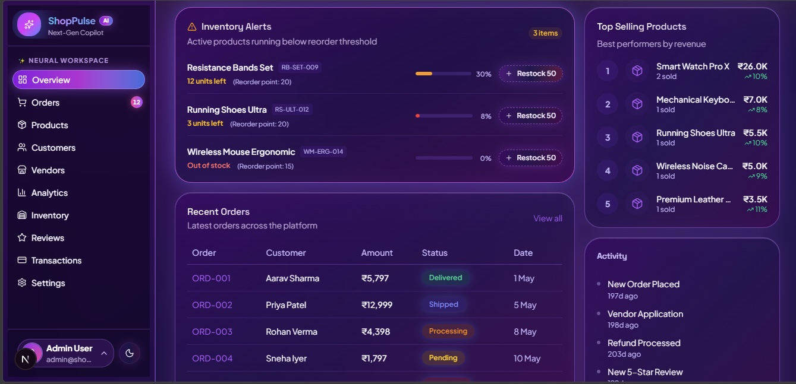
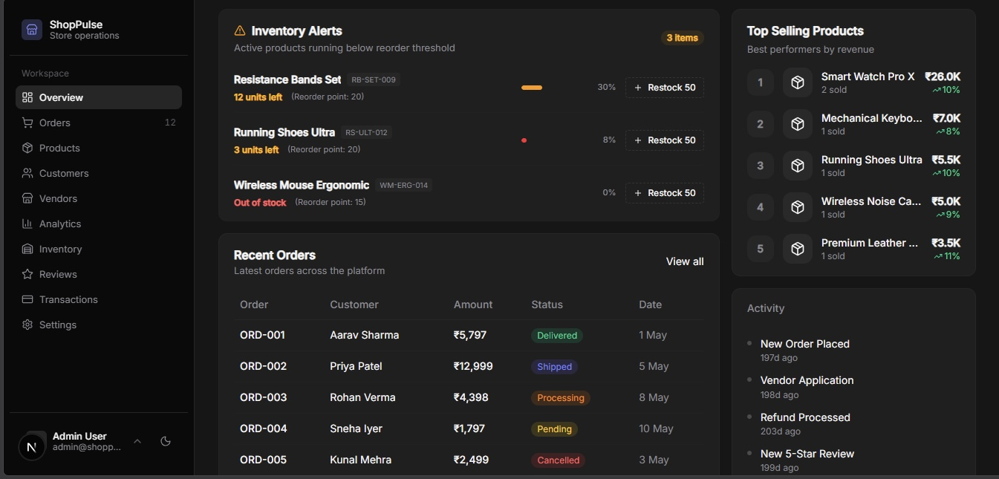

# Anti-Slop UI

**A design skill for AI coding agents that makes frontend interfaces look deliberately designed for *this* product — not generically AI-generated.**

Anti-Slop UI is a portable [Agent Skill](https://skills.sh/) written as Markdown, with two small Python helpers. It gives an agent a working design process: understand the product and audience, agree on a direction, make deliberate visual decisions, and prove that nothing functional was broken along the way.

---

## The problem it solves

AI-generated interfaces tend to converge. The same purple-blue gradient hero, the same glassmorphic card grid, the same three feature columns, the same boilerplate copy, the same rounded rectangle for every control. The result is not necessarily ugly — it is *undecided*. It looks like a template because every choice was made by default.

Anti-Slop UI treats "slop" as **a decision made by default, for no reason**. It does not ban gradients, cards, color, animation, or density. It asks the agent to justify each choice against the product, the audience, and the brand, and to keep the result coherent.

## Before & after

An example of using this skill's **Fix AI slop** workflow on an existing operations dashboard — removing unmotivated purple gradients, glow effects, and generic AI buzzword labels while keeping the layout, data, and controls intact:

| Before (generic AI slop) | After (with Anti-Slop UI) |
|---|---|
|  |  |

## Key capabilities

- **Eight task workflows** — build new UI, redesign, refine, audit, fix AI slop, polish a component, improve responsive layouts, and fix a visual bug. Each workflow defines its own scope, outputs, and edit permissions.
- **Interactive design intake** — a question bank that adapts to the task, plus a design-brief template and an explicit approval gate before substantial work.
- **A styles catalog with twelve directions** — precise neutral, warm commerce, playful, editorial, dark developer tool, expressive gradient/glass, neo-brutalist, soft/calm, luxury, maximalist, enterprise calm, and retro. Directions can be combined or replaced with a custom one.
- **Design-token guidance** — color architecture, typography, spacing, radius, shadow, motion, density, and presets that are starting points rather than requirements. Existing project tokens always win.
- **Component guidance** — buttons, inputs, chips, tabs, cards, navigation, overlays, data interfaces, feedback, and the "everything is the same rounded rectangle" trap.
- **Accessibility built into the visual work** — WCAG 2.2 AA target, contrast, focus, semantics, forms, target sizes, motion, reflow, and RTL.
- **A visual-only diff guard** — `scripts/diff_guard.py` heuristically flags changes to handlers, state, routes, API calls, forms, prop contracts, and dependencies so presentation work stays presentation work.
- **A contrast checker** — `scripts/contrast.py` computes WCAG contrast ratios and can validate a list of token pairs.
- **Honest reporting** — the skill forbids claiming verification that did not happen.

## Design philosophy: adapt to the user

The skill is deliberately customizable. Its first principle is:

> **Adapt to the user. Do not make the user adapt to this skill.**

- Minimalism is one valid style among many, not a synonym for quality.
- Every rule is tagged **[MUST]** (safety, honesty, accessibility floors), **[DEFAULT]** (a sensible starting point), or **[CONTEXT]** (a judgment call).
- Precedence is explicit: the user's instruction, then the approved brief, then the project's existing design system and brand, then supplied references, then technical conventions, then the skill's defaults.
- The agent must never overwrite a coherent existing design system without approval, and must follow the project's actual stack rather than introducing React, Tailwind, or a component library it does not use.

## Interactive design consultation

For substantial work, the agent runs a short consultation instead of guessing:

1. Ask roughly 5–8 relevant questions — product and audience, style, light/dark, brand and color, typography, density, motion, references, what to preserve, and how much creative freedom it has.
2. Skip anything already answered by the request, the repository, or attached references.
3. Offer example directions, but always allow combining them, describing a custom one, skipping a question, or saying "you decide".
4. Write a short design brief: goal, direction, palette roles, type, layout, motion, what will change, what stays unchanged, assumptions, and a verification plan.
5. Get approval before a redesign or other substantial restyle. In non-interactive runs, deliver the brief and proposal instead of starting a redesign.

## Visual-only modification protection

The default scope is **visual changes only**. Improve how it looks; do not silently change what it does.

- **Allowed:** CSS, utility classes, tokens, typography, color, spacing, layout, borders, surfaces, shadows, responsive styling, visual motion, and meaning-preserving icon swaps.
- **Allowed but disclosed:** wrapper markup that leaves handlers and props untouched, semantic-equivalent element swaps, additive accessibility attributes, new visual dependencies (ask first), and visible copy edits.
- **Forbidden without explicit permission:** business logic, state and hooks, event handlers, routing, API calls, data fetching, backend/auth code, form submission and validation, workflows, component props, and integrations.

If a visual request cannot be met without a functional change, the agent must stop that part, explain the conflict, offer a visual-only alternative, and ask — while continuing the rest of the visual work.

Before reporting completion, the agent reviews the full `git diff` and can run:

```bash
python3 skills/anti-slop-ui/scripts/diff_guard.py --repo . --json
```

The guard is a heuristic aid, not proof. The diff review is mandatory either way.

## Supported use cases

| You want to… | Workflow | Typical edit permission |
|---|---|---|
| Create a new interface | Build new UI | After brief approval |
| Change the visual direction of an existing UI | Redesign | Only after approval |
| Improve an existing UI while keeping its identity | Refine | Yes |
| Review an existing UI | Audit | No, unless implementation is requested |
| Remove generic-looking patterns | Fix AI slop | Yes, preserving identity |
| Improve one component | Component polish | That component only |
| Make it work on small/large screens | Responsive improvement | Yes |
| Fix a specific visual defect | Visual bug fix | Minimal |

It is **not** for backend work, business logic, data modeling, API design, or performance engineering. When a request mixes visual and functional work, the skill applies only to the visual part.

## Installation

Requires Node.js and npm. The skill itself needs no runtime dependencies; its optional Python helpers need Python 3.8+.

### Install with the Vercel Skills CLI

```bash
npx skills add Surajmaurya1/anti-slop-ui --skill anti-slop-ui
```

### Claude Code

```bash
npx skills add Surajmaurya1/anti-slop-ui --skill anti-slop-ui -a claude-code
```

### List skills without installing

```bash
npx skills add Surajmaurya1/anti-slop-ui --list
```

The repository ships a standard `SKILL.md` with YAML frontmatter and no agent-specific hooks. Claude Code is the only agent-specific install target shown here because it is the one exercised explicitly in the commands above. **Compatibility with other agents has not been independently verified**; use the Skills CLI's own agent detection, or install manually into the directory your agent documents for skills.

### Manual ZIP installation

1. Download the packaged skill: [`dist/anti-slop-ui-v1.0.0.zip`](https://github.com/Surajmaurya1/anti-slop-ui/raw/main/dist/anti-slop-ui-v1.0.0.zip).
2. Extract it. You get a single folder named `anti-slop-ui/` containing `SKILL.md`, `LICENSE`, `references/`, and `scripts/`.
3. Move or copy that folder into your agent's skills directory.
   - Claude Code, personal skills: `~/.claude/skills/anti-slop-ui/`
   - Claude Code, project skills: `.claude/skills/anti-slop-ui/`
   - Other agents: use the skills directory documented by that agent.
4. Confirm the skill is in place:

   ```bash
   test -f ~/.claude/skills/anti-slop-ui/SKILL.md && echo "Anti-Slop UI installed"
   ```

The ZIP has no external dependencies, no build step, and no `node_modules`. Do not extract it over an existing customized copy without backing that copy up first.

## Repository layout

```text
anti-slop-ui/
├── README.md
├── LICENSE
├── CHANGELOG.md
├── before.jpg
├── after.jpg
├── skills/
│   └── anti-slop-ui/
│       ├── SKILL.md
│       ├── references/
│       │   ├── accessibility.md
│       │   ├── components.md
│       │   ├── design-intake.md
│       │   ├── styles-catalog.md
│       │   ├── tokens.md
│       │   └── workflows.md
│       ├── scripts/
│       │   ├── contrast.py
│       │   └── diff_guard.py
│       └── tests/
│           ├── contrast-pairs.txt
│           ├── test_contrast.py
│           ├── test_diff_guard.py
│           └── fixtures/sample-app/
└── dist/
    └── anti-slop-ui-v1.0.0.zip
```

`skills/anti-slop-ui/` is the source of truth and the path the Skills CLI discovers. `dist/` contains the same skill packaged for manual installation, including `SKILL.md`, `LICENSE`, `references/`, and `scripts/`; the development tests stay in the repository. See [`CHANGELOG.md`](CHANGELOG.md) for release notes and known gaps.

## Optional Python helpers

```bash
# Contrast ratio between two colors
python3 skills/anti-slop-ui/scripts/contrast.py "#111827" "#ffffff"

# Validate every pair in a token file
python3 skills/anti-slop-ui/scripts/contrast.py --pairs skills/anti-slop-ui/tests/contrast-pairs.txt

# Heuristic visual-only diff review
python3 skills/anti-slop-ui/scripts/diff_guard.py --repo . --json
```

Run the skill's tests with:

```bash
python3 -m unittest discover -s skills/anti-slop-ui/tests -p "test_*.py" -v
```

## Contributing

Issues and pull requests are welcome.

- Open an issue before large changes to the skill's rules, workflows, or references.
- Keep `SKILL.md` frontmatter valid YAML, with a `name` matching the folder (`anti-slop-ui`) and a specific `description`.
- Preserve the visual-only policy and the honesty requirements; they are the point of the skill, not decoration.
- Prefer editing an existing reference document over adding a new top-level concept.
- Run the Python tests before opening a PR, and report anything you could not verify.
- Do not add compatibility claims for agents that have not been tested.

## License

Anti-Slop UI is open source and available under the MIT License.

Copyright (c) 2026 Suraj Maurya.

See the [LICENSE](./LICENSE) file for the complete license terms.
